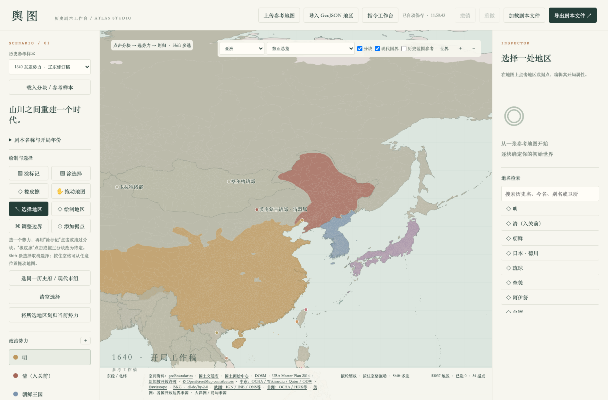
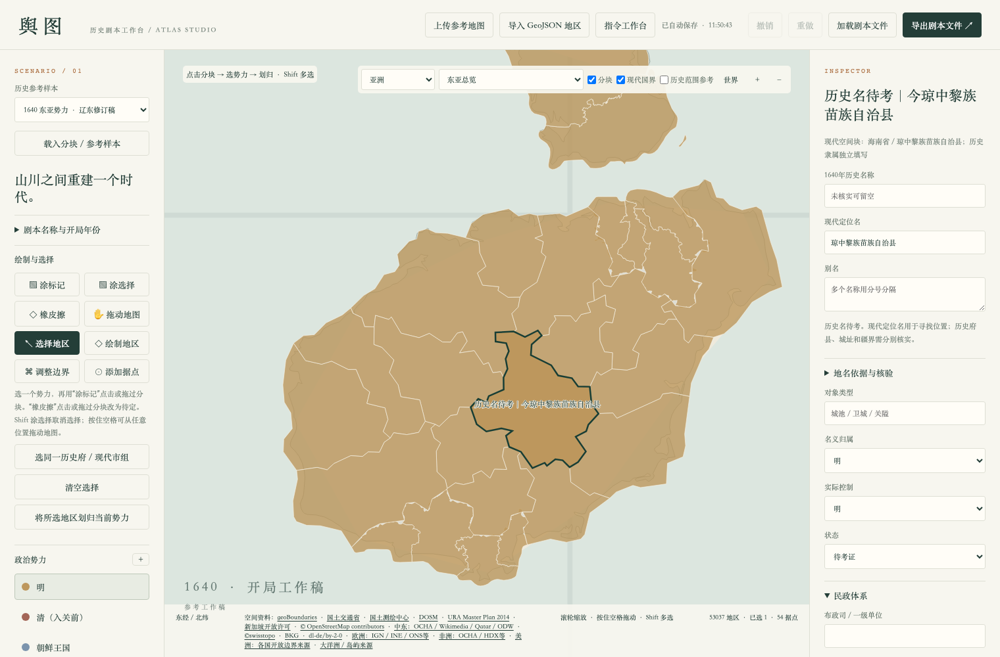
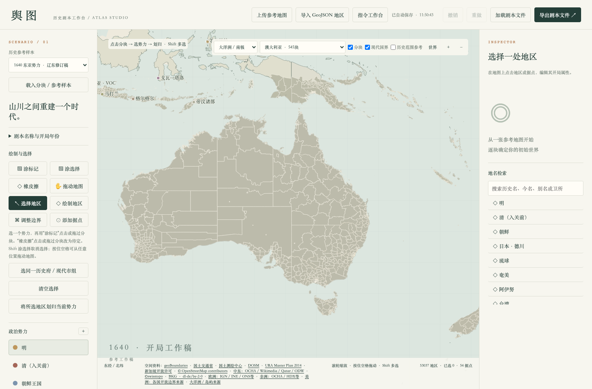

# 舆图 · yutu

在本地浏览器中编辑历史开局地图的工作台。选择分块、拖动标色、修改势力颜色、填写历史名称和属性，支持橡皮擦、多选划归、撤销重做及 JSON 剧本导入导出。

目前包含 53,037 个地区和 54 个据点。现代行政分块和半透明现代国界用于空间定位，历史归属、控制和地名仍需人工核实。

线上体验已下线。当前版本加载全球地图资料，在线加载和浏览器内存开销较大，推荐下载后本地使用。

## 界面预览

### 东亚总览与两级定位菜单



### 县块选择与编辑



### 全球分块与现代国界参考



## 本地使用

无需 npm 或构建工具，安装 Python 3 后在仓库目录运行：

```sh
python3 -m http.server 8000 --directory public
```

在浏览器打开 [本地工作台](http://localhost:8000)，等待顶部地图加载提示结束。推荐桌面端新版浏览器，并保持同一地址和端口，以便恢复浏览器自动保存的工作稿。

- 按住空格并拖动鼠标，从陆地或海洋平移；也可以选择“拖动地图”。
- “涂标记”连续划归，“橡皮擦”把当前标色属性改为待定；一笔可撤销。
- 点击势力名称选择，点击左侧颜色圆点直接改色；最近使用的势力排在前面。
- Shift 点击多选，再点击“将所选地区划归当前势力”。
- 顶部按“大洲 → 区域／国家”定位，“现代国界”和“历史范围参考”可独立开关，参考层不拦截选择。
- “导出剧本文件”下载完整地图边界、势力与属性 JSON；“加载剧本文件”打开已有 JSON 并替换工作稿。浏览器自动保存之外，请定期导出备份。

导出的文件用于本编辑器或后续引擎接入，目前尚不能直接启动游戏。处理和存档均在本地浏览器中完成。世界远景、完整导出仍可能耗时或占用较多内存。

## 仓库结构

- `public/`：编辑器页面、代码和运行所需资料。
- `public/data/maps/`：压缩数据块及清单。
- `public/sources/`：来源、许可和年代记录。
- `docs/screenshots/`：README 界面截图，来自隔离浏览器，不含个人工作稿。
- `scripts/`：数据打包、解码和完整性检查。
- `tests/`：本地浏览器烟雾检查。

## 验证与更新

```sh
python3 scripts/check_release.py
pip install playwright
playwright install chromium
python3 tests/smoke.py
```

GitHub Pages 自动部署已移除。地图资料署名和许可见 [NOTICE.md](NOTICE.md) 与 [来源目录](public/sources/index.html)。代码与第三方地图资料分别遵循其权利和许可说明。
